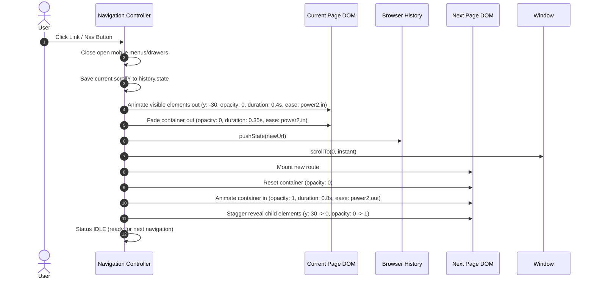

# RASAS Page Navigation Transition Analysis

**Reference Target:** [https://rasas.co/ar](https://rasas.co/ar)  
**Analyzed Bundle:** `assets/index-C52LtYIy.js` & `assets/app-CLcUzLpC.js` (Vite production bundle from live rasas.co)  
**Date of Analysis:** 2026-10-27

---

## 1. Executive Summary & Core Findings

Unlike initial assumptions of card-expansion or solid color curtain wipes, **RASAS uses a refined, cinematic, viewport-aware micro-staggered exit and entrance animation system**:
1. **Background Stability:** The background, canvas atmosphere, and navigation chrome stay mounted and visible. There is no heavy overlay wipe that blinds the screen.
2. **Selective Viewport Exit:** Visible viewport elements (`[data-reveal]` with `top < innerHeight && bottom > 0`) animate out with subtle upward translation (`y: -30px`, `opacity: 0`) using `power2.in` (duration ~`0.4s`).
3. **Container Fade:** The main container (`#main`) fades out completely (`opacity: 0`, `duration: 0.35s`, `power2.in`).
4. **Deterministic Route Swap:**
   - Scroll position is instantly set to top `0` (or restored to previous offset during `popstate`).
   - URL history is updated (`pushState`).
   - DOM / React route component mounts.
5. **Fluid Content Entrance:**
   - Main container fades in (`opacity: 0` to `1`, `duration: 0.8s`, `ease: power2.out`).
   - New page elements animate in with upward recovery (`y: 30px` to `0`, `opacity: 0` to `1`, staggered ~`0.05s - 0.1s`).
6. **Interaction Protection:** Navigation calls are serialized in a Promise chain (`Se(() => Fe(...))`), preventing duplicate executions from rapid clicking.
7. **Accessibility:** Supports `prefers-reduced-motion` to bypass movement animations for users who prefer reduced motion.

---

## 2. Technical Motion Sequence & Parameters

### Exact Animation Timings (Observed from `rasas-app.js`):
- **Exit Reveal Elements:** `y: -30`, `opacity: 0`, `duration: 0.4s`, `ease: "power2.in"`
- **Exit Main Container:** `opacity: 0`, `duration: 0.35s`, `ease: "power2.in"`
- **Total Exit Duration:** ~`0.40s`
- **Route Switch Point:** Exactly after exit completion, before entrance.
- **Scroll Reset:** Instantaneous `window.scrollTo({ top: 0, behavior: "instant" })`
- **Entrance Container:** `opacity: 0 -> 1`, `duration: 0.8s`, `ease: "power2.out"`
- **Entrance Stagger:** `duration: 0.7s - 0.9s`, `ease: "power2.out"`, `stagger: 0.06s`
- **Total Navigation Cycle:** ~`1.2s`

---

## 3. Discrepancies in AL OSH Portfolio Prior Implementation

The current implementation in `src/App.tsx`:
1. Used a FLIP card-expansion effect (`cinematic-flip-overlay`) that blew up a card into full screen.
2. Mixed this with arbitrary `setTimeout(..., 500)` and separate `navigateBackToHome` / `navigateDirect` logic.
3. Left floating dock links and cards behaving inconsistently (cards expanding, dock fading abruptly).
4. Had potential race conditions on rapid clicks or browser back/forward buttons.

---

## 4. Replacement Strategy

We will replace the disparate navigation methods with a single, unified transition architecture:
- `src/transitions/TransitionProvider.tsx`: Central motion manager and state machine (`IDLE → EXIT → ROUTE_SWAP → ENTER → IDLE`).
- `src/transitions/usePageNavigation.ts`: Universal navigation hook used by:
  - Homepage 4 cards
  - Floating dock icons
  - Mobile menu links
  - Subpage "Return to Home" buttons and breadcrumbs
  - Browser `popstate` (Back / Forward)
- Automatic cleanup of old FLIP overlay styles and unified GSAP timeline execution.
